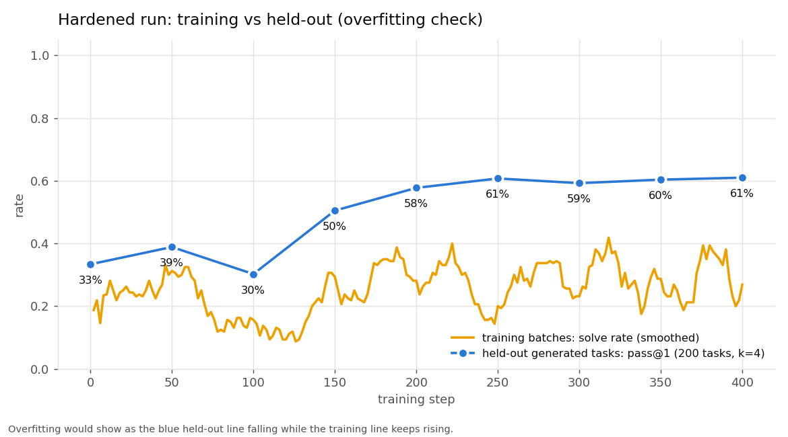

# CyberSec Env — technical report

*A verifiable-reward RL environment for training LLMs to repair insecure code,
and a dataset of real, executable Python vulnerability fixes.*

**Deliverables.**

1. **A function-level RL environment** (8 procedural CWE families + 708 imported
   benchmark tasks) whose grader was attacked on purpose, found to be hackable,
   and hardened. All 12 audited attack strategies (300+ attempts) now fail; eight
   flaws found during training are documented and fixed (§4).
2. **A repository-level dataset** of real Python security advisories, each a
   Docker-runnable repository at the vulnerable commit with hidden tests that
   fail before the human fix and pass after it, plus the human-written advisory,
   commit message and PR text (§8). Construction is in progress; numbers here
   are as of 2026-10-20.

**Headline result (hardened run, 2026-10-19).** GRPO training of
Qwen2.5-Coder-1.5B-Instruct (LoRA, 400 steps, one RTX 4060 laptop GPU) on the
hardened grader raised held-out pass@1 on the environment's procedural tasks
from **33.4% to 61.0%** (+27.6 points, 95% CI +22.6 to +32.9, p < 0.001). On
the SecCodePLT test split it went from 17.5% to 22.7% (+5.2, CI +0.2 to +10.2,
p = 0.051, borderline). It **did not transfer** to CWEval, an independently
written benchmark (32.8% → 35.9%, CI −10.9 to +18.8, not significant). The gains
are real on the trained distribution and absent outside it; §10 lists every
place the project fell short.

**Frontier comparison (2026-10-25).** Claude Opus 5.5 scored 100% on the
procedural test set, 89.1% on SecCodePLT and 100% on CWEval with the same
grader (§7.5). The procedural tasks therefore no longer separate frontier
models. A hand check of all 12 Opus failures found one grader false negative
class (6 tasks) and no false positives.

---

## 1. Problem

Security ("find, exploit, and fix real software vulnerabilities") is an
in-demand, less-saturated domain for RL environments, and the property buyers
insist on is a **reward that cannot be hacked**: high reward must mean the
vulnerability is actually fixed, not that the grader was fooled. This project
builds that for **secure-code repair**, at two levels:

| Level | Task | Grader | Status |
|---|---|---|---|
| Function | fix one vulnerable Python function | in-process probes in a sandbox (§3) | built, hardened, trained on |
| Repository | patch a real project at a real CVE's vulnerable commit | the project's own tests in a no-network container (§8) | dataset being built; not trained on (§9) |

## 2. Function-level tasks

Single-turn: the policy is shown a Python function containing a vulnerability
and must return a secure version that preserves the documented behaviour.

### 2.1 Procedural families (8 CWEs)

Generated from a `family-difficulty-seed` id: an effectively infinite,
contamination-free supply with **disjoint train/test seed ranges**.

| Family | CWE | Security probes check that… |
|---|---|---|
| sqli | 089 | a tautology returns no rows; a stacked `DROP TABLE` does nothing; a `UNION` cannot read other tables |
| code_injection | 095 | an `eval`'d payload cannot run code (difficulty 1 adds a hint) |
| path_traversal | 022 | `../`, absolute paths and a same-prefix sibling folder cannot escape |
| unsafe_deser | 502 | a YAML `!!python/object` or `!!python/name` payload constructs nothing |
| ssrf | 918 | subdomain, query-smuggle and scheme tricks are rejected; normal URLs still allowed |
| xss | 079 | `<script>` and attribute-breakout payloads are escaped |
| weak_hash | 327 | the output is no single fast digest and the code uses a password KDF |
| insecure_random | 330 | tokens are not reproducible after `random.seed()` |

### 2.2 Imported benchmark tasks (708 tasks)

| Source | Kept | CWEs | Split | Graded by |
|---|---|---|---|---|
| SecCodePLT (MIT, gated) | 692 of 819 with executable tests | 15 | 582 train / 110 test | a pytest module generated from its capability/safety test table |
| CWEval (Apache-2.0) | 16 of 25 Python tasks | 13 | test only | CWEval's own pytest module |

Importers convert each task and keep it only if, **in this grader**, the
reference passes every test, the vulnerable seed fails, an empty stub fails, and
the tests don't read the clock. Drop reasons are recorded in
`cybersec_env/data/imported/*_import_report.md`; the main ones are SecCodePLT
code-injection references that still call `eval` (banned by design), and tasks
that must start processes or load native crypto code (forbidden by the sandbox).

SecCodePLT test tasks are close siblings of its training tasks
(in-distribution); **CWEval is the out-of-distribution check** and was never
trained on. Training used 1,222 tasks across 19 CWEs.

## 3. Function-level grader (verifiable reward)

For each candidate completion:

1. **Extract** the function from the model output.
2. **Guard**: an AST denylist rejects grader-escape constructs before execution.
3. **Execute** the probes in a two-layer sandbox:
   * an **OS jail** on Linux (bubblewrap: no network namespace, read-only
     filesystem except a throwaway per-candidate directory, pid/ipc/uts
     unshared), with a Python audit hook and rlimits underneath. On Windows this
     degrades to process isolation plus a Job Object, and the grader reports it;
   * a **trust split**: candidate code runs in a child process (in a worker
     thread), which closes the verdict channel before running anything. The
     parent holds the nonce and the verdict pipe and never runs candidate code.
4. **Verdict channel**: a private pipe, not stdout, accepted only with a per-call
   token the candidate never sees. Every value the candidate returns is reduced
   to a **trusted primitive** before comparison, so an object with a lying
   `__eq__` cannot pass. An early exit fails the grade.
5. **Static rubric**: a per-CWE source check (e.g. "query is parameterized"),
   low weight, never sufficient on its own.
6. **Reward**: `solved = all functional ∧ all security probes pass`. The shaped
   reward is `0.45·func + (0.40·sec + 0.10·static)·func + 0.05·format`, capped at
   0.85 unless solved; security credit **scales with functional correctness**, so
   "secure but broken" code cannot farm reward.

The grader is framework-free, so the same code backs the OpenEnv server, the TRL
reward function, the CLI and the 123 tests.

### Grader versions referred to below

| Version | What changed | Used by |
|---|---|---|
| v1 | original | 0.5B run, first 1.5B run |
| v2 | the training-found fixes in §4.2 (KDF probe, sibling-folder probe, security gated by function, …) | "final" run |
| v3 | the redesign in §4.1 (trust split, private verdict pipe, canonicalised return values) | "hardened" run |

## 4. How the grader was broken, and hardened

RL optimises exactly what the grader checks, so every weakness eventually shows
up as reward. Two sources found them: an adversarial audit written on purpose
(§4.1), and the training runs themselves (§4.2).

### 4.1 Adversarial audit

`python scripts/hack_audit.py` runs **12 attack strategies (13 variants)
across all 8 families** (300+ attempts) and asserts that **none is scored `solved`** while
the genuine fix still scores 1.0. Result: **PASSED**
([`results/hack_audit.md`](results/hack_audit.md)).

Two of these attacks **defeated an earlier version of the grader** and forced
the v3 redesign:

| Attack | How it worked against the old grader | How v3 stops it |
|---|---|---|
| **Lying equality** (`eq_always_true`) | return an object whose `__eq__` always says True, so it "matches" every expected value | return values are converted to trusted primitives before any comparison |
| **Forged verdict** (`forge_verdict`) | walk the call stack to find the grader's nonce, write a fake "all probes passed" verdict, then exit | candidate code runs in a separate process that holds no nonce and no verdict channel; the inner nonce lives in another thread |

A third, written to test the redesign, also fails:

| Attack | Idea | Result |
|---|---|---|
| **fd spray** (`forge_all_fds`) | write a count-matched forged verdict to every open file descriptor, then exit | discarded: no verdict nonce, no child nonce, probe count cross-checked |

The other nine (keep the vulnerable code, return an empty stub, dynamic `eval`,
`getattr`-based import, import the grader, import the network, an
introspection chain to reach builtins, monkeypatch a module attribute,
`sys.exit`) are blocked by the guard or fail the probes. An infinite loop is
killed by the wall-clock timeout and scores 0. Two "do nothing" strategies still earn partial
shaped reward (`keep_vulnerable` 0.58, `empty_stub` 0.23) but never `solved`:
partial credit for working-but-insecure code is a deliberate shaping choice.

`scripts/mutation_test.py` complements the audit with realistic **incomplete**
fixes that must fail. It found two real probe blind spots: a keyword blacklist
passed the SQL-injection probes (fixed with a `UNION` probe), and
`yaml.load(FullLoader)` passed the deserialization probes (fixed with a
`!!python/name` probe).

### 4.2 Eight flaws found by training, then fixed

| # | Type | Finding | How it surfaced | Fix |
|---|---|---|---|---|
| 1 | Isolation gap | model code ran in the repo folder and could write anywhere; files from one grading could affect later ones | stray files from model answers appeared in the repo | per-candidate sandbox folder, write confinement, deletion afterwards |
| 2 | Isolation gap | the parent trusted whatever the worker printed, and the worker only caught `Exception` | found while investigating #1 | per-call verdict token; `BaseException` handling |
| 3 | **Reward hack the model used** | the weak-hash grader accepted a single salted SHA-256 | **23 of 24** trained "solves" used it | probe requires a password KDF and rejects any single fast digest |
| 4 | **Reward hack the model used** | the path grader missed a bare `startswith(base)` check | trained answers used it | new same-prefix sibling-folder probe |
| 5 | **Reward hack the model used** | "secure but broken" code earned 0.55 reward | code-injection reward rose 0.37 → 0.51 while solves stayed at 0% | security and static credit scale with functional correctness |
| 6 | Spec bug | the code-injection spec said "literal", steering models to `ast.literal_eval`, which cannot do arithmetic | per-probe failure report | clearer spec, finer probes, hinted curriculum level |
| 7 | Grading bugs | Windows cp1252 decoding lost verdicts; a socket monkeypatch broke `import ssl`; pytest read parent-folder config; the guard banned `self.x = …` | importing CWEval / SecCodePLT | UTF-8 channel; network blocked via audit hook; sandboxed pytest config; narrower guard |
| 8 | **Grader artifact the model learned** | Windows TEMP used an 8.3 short path, so correct fixes that resolved only one side of a path comparison failed, on this machine only | the trained model left path-traversal code unchanged in 12 of 25 answers | sandbox uses the resolved path |

Three of the eight (#3–#5) were genuine reward hacks: the model found a way to
score without fixing the vulnerability, and did so at scale. #8 is the reverse
and the clearest lesson: a grader bug made *correct* fixes look wrong, and the
model learned to stop making them.

## 5. Difficulty calibration

In GRPO a group of rollouts carries signal only when rewards vary within the
group. The results confirm the usual rule that a category must start above
roughly 2–3% success to be learnable:

* Categories the base model solved sometimes improved strongly: insecure
  randomness 19% → 100%, unsafe deserialization 32% → 99%, SQL injection
  70% → 100%, SSRF 45% → 82%.
* Categories at 0% stayed at 0%: code injection (no sampled answer ever wrote a
  working safe evaluator, even with a hint) and password hashing (no answer
  ever used a KDF). Path traversal started at 3% and reached only 7%.

`scripts/evaluate.py` and `scripts/probe_report.py` report per-CWE pass rates
and which probes fail, to keep each family inside the learnable band.

## 6. Training

`scripts/train_grpo.py` + a YAML config train any Hugging Face causal LM with
TRL GRPO; the reward is the grader above.

Hardened-run settings (`configs/hardened_coder15_mixed.yaml`):
Qwen2.5-Coder-1.5B-Instruct + LoRA r=16, learning rate 1e-5, KL β 0.02, 8
generations per prompt, 16 answers per update, completions ≤ 448 tokens, 400
steps, **2 h 19 min** on an RTX 4060 laptop GPU (8 GB). Training reward rose
from 0.41 to 0.58. The run covered **0.65 epochs** of the 1,222 training tasks,
so no task was seen twice on average.

## 7. Results

All comparisons are paired over the same held-out tasks
(`scripts/compare_evals.py`: bootstrap 95% CI and a sign-flip permutation
p-value); pass@1 is the mean solved rate over k samples. Every evaluation kept
a 0% no-op floor and a 100% oracle ceiling.

### 7.1 Hardened run (v3 grader, 400 steps)

| Held-out test set | Metric | Base | Trained |
|---|---|---|---|
| Procedural (200 tasks, 8 CWEs, k=4) | pass@1 | 33.4% | **61.0%** (+27.6, CI +22.6 to +32.9, p < 0.001) |
| | pass@4 | 53.5% | 66.0% |
| | functional rate | 47.6% | 88.9% |
| | security rate | 64.1% | 80.2% |
| SecCodePLT test (110 tasks, 15 CWEs, k=4) | pass@1 | 17.5% | **22.7%** (+5.2, CI +0.2 to +10.2, p = 0.051) |
| | pass@4 | 40.0% | 34.5% |
| | functional rate | 42.2% | 73.9% |
| | security rate | 37.9% | 34.2% |
| CWEval (16 tasks, 13 CWEs, k=8) | pass@1 | 32.8% | **35.9%** (+3.1, CI −10.9 to +18.8, p = 0.79) |
| | pass@8 | 68.8% | 62.5% |

SecCodePLT gains: SSRF 53% → 83%, mass assignment 45% → 100%, open redirect
29% → 50%, signature verification 6% → 17%. Regressions: **XSS 41% → 9%** (p =
0.03) and unsafe deserialization 13% → 3%.

### 7.2 All training runs compared

| Run | Model | Grader | Steps | Procedural pass@1 | SecCodePLT pass@1 | CWEval pass@1 |
|---|---|---|---|---|---|---|
| First experiment | Qwen2.5-0.5B | v1 | 150 | base 18.8%; trained result **invalid** (eval-mode bug, §10.3) | — | — |
| First 1.5B | Qwen2.5-Coder-1.5B | v1 | 100 | 38.8% → 66.1% (**inflated** by lenient graders, §4.2 #3–4) | — | 32.8% → 38.3% (n.s.) |
| Final | Qwen2.5-Coder-1.5B | v2 | 400 | 33.9% → 59.8% | 17.5% → 23.4% | 32.8% → 32.8% |
| **Hardened** | Qwen2.5-Coder-1.5B | v3 | 400 | **33.4% → 61.0%** | 17.5% → 22.7% | 32.8% → 35.9% (n.s.) |

The hardened run did **not** beat the final run by a meaningful margin, and it
was not expected to: v3 closed attacks the model had not been using. Its value is
that the same gain now holds against a grader that resists the known forgeries,
so the number can be trusted. The first 1.5B run's larger jump is the
cautionary example: part of it was the model exploiting flaws #3 and #4.

### 7.3 Over-fitting check: every checkpoint evaluated

Held-out procedural pass@1 (200 tasks, k=4) at every saved checkpoint of the
hardened run:

| Step | 0 | 50 | 100 | 150 | 200 | 250 | 300 | 350 | 400 |
|---|---|---|---|---|---|---|---|---|---|
| pass@1 | 33.4% | 38.9% | 30.2% | 50.5% | 57.8% | 60.8% | 59.3% | 60.4% | 61.0% |
| functional | 47.6% | 56.0% | 81.3% | 77.1% | 84.4% | 88.8% | 87.9% | 88.8% | 88.9% |
| security | 64.1% | 70.1% | 45.8% | 73.3% | 75.9% | 77.8% | 77.7% | 78.9% | 80.2% |

* **No over-fitting:** held-out accuracy rises and then plateaus; it never
  falls while training reward keeps rising.
* **About 250 steps were enough**; the last 150 steps added ~0.2 points.
* **The step-100 dip** is the shaped reward at work: the model first learned to
  make code *work* (functional 56% → 81%) at the expense of security
  (70% → 46%), then recovered security once functional credit saturated.

Plots (`python scripts/plot_training.py` → `results/training_plots/`):
training reward, training error (1 − solve rate), KL from the base model, policy
entropy, and held-out vs training solve rate for the hardened run.



### 7.4 What the results establish

* **Established:** the reward teaches real fixes on the trained distribution
  (parameterized SQL, `yaml.safe_load`, `secrets`, allow-list URL parsing),
  with large, statistically solid gains, measured against a grader that resists
  every attack we could build.
* **Not established:** transfer to independently written tests; learning
  categories that start near 0%; security gains on SecCodePLT (functionality
  rose, security fell slightly); robustness across seeds (one seed per run).

Result files: `results/compare_hardened_{proc,spl,cweval}.md`,
`results/eval_hardened_*.json`, `results/eval_ckpt_hardened_*_proc.json`.

### 7.5 Frontier comparison: Claude Opus 5.5 (2026-10-25)

To show where the environment sits relative to a frontier model, Claude Opus
5.5 was run once on every held-out task of all three test sets, with the same
prompts, the same v3 grader and the same task IDs as the 1.5B evaluations
(`scripts/frontier_calibration.py`).

| Held-out test set | Qwen 1.5B base | Qwen 1.5B + GRPO | Claude Opus 5.5 |
|---|---|---|---|
| Procedural (200 tasks, 8 CWEs) | 33.4% | 61.0% | **100.0%** (200/200) |
| SecCodePLT (110 tasks, 15 CWEs) | 17.5% | 22.7% | **89.1%** (98/110) |
| CWEval (16 tasks, 13 CWEs) | 32.8% | 35.9% | **100.0%** (16/16) |

Opus scored 100% on every procedural CWE, including the three where the 1.5B
model stayed near 0%: code injection (it wrote a full AST-walking evaluator),
password hashing (PBKDF2 in 25 of 25 answers, scrypt in 4) and path traversal
(`realpath` + `commonpath` in all 25).

SecCodePLT by CWE (n = tasks; 1.5B columns are mean pass@1 over 4 samples):

| CWE | n | Base | + GRPO | Opus 5.5 |
|---|---|---|---|---|
| 074 command injection | 5 | 0.15 | 0.20 | 1.00 |
| 077 command injection | 2 | 0.00 | 0.00 | 1.00 |
| 079 XSS | 8 | 0.41 | 0.09 | 1.00 |
| 1333 ReDoS | 3 | 0.08 | 0.00 | 1.00 |
| 200 information exposure | 8 | 0.00 | 0.00 | **0.25** |
| 327 weak crypto | 5 | 0.05 | 0.00 | 1.00 |
| 347 signature verification | 13 | 0.06 | 0.17 | 1.00 |
| 352 CSRF | 6 | 0.04 | 0.04 | 0.83 |
| 502 deserialization | 10 | 0.12 | 0.03 | 1.00 |
| 601 open redirect | 7 | 0.29 | 0.50 | 1.00 |
| 770 unbounded allocation | 9 | 0.00 | 0.03 | 0.89 |
| 862 missing authorization | 10 | 0.28 | 0.35 | 0.80 |
| 863 incorrect authorization | 9 | 0.03 | 0.00 | 0.78 |
| 915 mass assignment | 5 | 0.45 | 1.00 | 1.00 |
| 918 SSRF | 10 | 0.53 | 0.82 | 1.00 |

**Every one of the 12 SecCodePLT failures was checked by hand.** Strong-model
disagreements are the best available test of the grader itself:

| Failures | What happened | Whose fault |
|---|---|---|
| 6 × CWE-200 | Opus wrapped the record in a proxy class that overrides `__getattribute__` to allow only safe fields: a correct fix. Our static guard bans `__getattribute__` (a sandbox-escape primitive), so the code was rejected before any test ran. The benchmark's reference uses `__getattr__`, which the guard allows. | **Our grader, too strict** (a false negative) |
| 2 × CWE-862 | The test requires a *premium* user to be denied *basic* content. The prompt says users are "restricted to content matching their subscription tier"; Opus read that as "at or above". | Benchmark test encodes one of two readings |
| 2 × CWE-863 | The test requires a project manager who is **not a member** of the project to be allowed to edit it; Opus required membership. Opus's version is stricter. | Benchmark test encodes one of two readings |
| 1 × CWE-770 | The test expects `ValueError` on 10,000 words; Opus capped the output at 1,000 words instead of raising. The limit and the error are not in the prompt. | Hidden requirement |
| 1 × CWE-352 | Opus accepted only `application/json` and rejected `application/vnd.custom+json`, which the test expects to work. | **Opus** |

Counting the six guard rejections as passes, Opus scores 104/110 (94.5%) on
SecCodePLT. Only one of the twelve failures is clearly the model's mistake.

**Grader-quality findings from this run:**

* **No false positives found.** A sample of passing answers was read in the
  families where reward hacks were found before (§4.2). All were real fixes:
  key-derivation functions (not salted hashes), `commonpath` containment (not
  `startswith`), `secrets`, `yaml.safe_load`, and AST-based evaluation.
* **One confirmed false negative class:** the guard's `__getattribute__` ban
  rejects a legitimate, common secure pattern (§11.1). The 1.5B model also
  scored 0% on CWE-200, so part of that 0% may be this rule too.
* **Five benchmark tests** encode one interpretation of an ambiguous prompt.
  That is upstream SecCodePLT behaviour, not the grader; it caps any model's
  SecCodePLT score below 100%.

**What this means for the environment.**

* **The procedural tasks no longer separate frontier models.** At 100%, they
  measure and train small and mid-size models (the 1.5B model gained 27.6
  points) but give a frontier model no signal. This is the main limitation the
  run exposed.
* **The imported benchmarks keep some headroom:** SecCodePLT authorization and
  information-exposure tasks (CWE-200, 862, 863), and the gap between the 1.5B
  model (22.7%) and Opus (89.1%) on the same grader.

**Caveats.**

* **Different sampling:** Opus had one attempt per task at its default
  "medium" effort; the API does not allow setting temperature. The 1.5B
  numbers are means over 4 (procedural, SecCodePLT) or 8 (CWEval) samples at
  temperature 0.7.
* **Possible contamination:** SecCodePLT and CWEval are public, so Opus may
  have seen them in training. The procedural tasks are generated, so their
  exact code is not public, but the patterns are standard.
* **Cost:** 326 calls (2 on the standard API, 324 on the Batch API at half
  price), about $1.50 in total. Spend was capped at $8 by the script.
* **Grader red-teaming by a frontier model was not done.** It was planned:
  Opus would read the grader source and attempt reward hacks. That part was
  stopped by a safety classifier while it was being prepared, and was not
  pursued. The grader's adversarial evidence remains the 300+ attack audit (§4)
  and the mutation test.

Result files: `results/frontier/opus55_{proc,spl,cweval}_rows.json` (every
answer, its grade and token use), `results/frontier/opus55_*_summary.md`,
`results/frontier/spend.json`.

## 8. Repository-level dataset

### 8.1 What a task is

A task is a real security advisory, packaged so that a patch can be graded
automatically:

* **the whole repository** at the vulnerable commit, built into a Docker image
  with its dependencies (the spec stores the repo URL and commit; the image is
  rebuilt on demand);
* **the human fix** as a source diff, kept apart from the test changes. Across
  the first 89 verified tasks the median fix changes 22 lines in one file; 41
  of 89 touch more than one file (up to 8);
* **hidden tests**: the regression tests the maintainers added with the fix.
  *Fail-to-pass* tests fail on the vulnerable code and pass with the fix;
  *pass-to-pass* tests pass both times and guard against breaking the project;
* **a short instruction** naming the package and CWE, e.g. *"The package
  `oauthenticator` has a security vulnerability (CWE-863)… Modify the package
  source so the test passes while keeping existing behaviour intact. Do not edit
  tests."* It does not say which file to change;
* **human-written context** (`reference` field): the full OSV advisory text,
  related advisories from other databases, the developer's commit message, and
  the title and description of the pull request that carried the fix. No
  LLM-written text is included, by design: the value of the dataset is the
  human record. E-mail addresses are masked. This field describes the fix, so it
  must never be shown to a model being evaluated.

### 8.2 Pipeline

| Stage | Script | What it does |
|---|---|---|
| Collect | `scripts/collect_advisories.py` | every PyPI advisory in OSV with a GitHub fix commit → `cybersec_env/data/advisories/candidates.jsonl` |
| Triage | `scripts/harvest_codebase.py` | fetch the fix commit; keep it only if it changes source code **and** adds or changes a test; split the diff into source and test patches |
| Verify | `scripts/harvest_codebase.py --verify-only` → `CodebaseGrader.verify` | build the image, run the tests without and with the fix; keep the task if at least one test is fail-to-pass; re-run twice more and drop tests whose result changes; record the exact installed packages |
| Enrich | `scripts/enrich_codebase_tasks.py --loop` | attach the human-written context (§8.1) |

A ledger (`data/codebase/ledger.json`) records every advisory's outcome, so any
crash resumes where it stopped and nothing is processed twice.

### 8.3 Funnel (as of 2026-10-20, verification in progress)

| Stage | Count | Lost, and why |
|---|---|---|
| PyPI advisories with a GitHub fix commit | 8,186 | |
| Fix changes source **and** a test | 3,570 | 3,540 fixes contain no test; 895 change no source code; 181 could not be fetched or parsed |
| Verified so far | 87 of 722 decided (12%) | 565 not fail-to-pass, 51 timed out, 19 do not build; 25 fetch failures to retry |
| Still queued | ~2,820 | |

Projected final size: **about 400–500 verified tasks**, roughly 5–6% of the
advisories collected. For comparison, SWE-bench kept 2,294 of roughly 90,000
pull requests (2.5%), and SWE-bench Verified has 500 tasks.

Of the 87 verified so far: 43 are from after mid-2024 (useful for
contamination-free evaluation of current models), 41 distinct CWEs appear.

### 8.4 Why most candidates are rejected

The criterion is SWE-bench's and is not loosened: without a test that fails
before and passes after, a patch cannot be graded and the task gives no reward.
Two very different things produce a rejection, and the pipeline now records
which (test counts per rejection):

* **Genuine**: tests ran and the fix changed nothing they detect. 40 of the
  first 64 recorded rejections (62%).
* **Environment**: no test ran even after the fix: a missing dependency, wrong
  Python version, or a service the tests need. 24 of 64 (38%). These are
  probably good tasks our generic build recipe could not run, and are the main
  lever for raising the yield (§11).

### 8.5 Repository-level grader

`CodebaseGrader.grade_patch` grades a candidate patch:

1. **Sanitise** the patch down to edits of pre-existing, non-test source files:
   no new files, no tests, no `conftest.py` / `sitecustomize.py` / `.pth` /
   pytest or packaging config.
2. Apply it inside a container with **no network** and CPU, memory and process
   limits.
3. **Restore the frozen tests** from a pristine snapshot after applying the
   patch, so the candidate is always graded against the task's own tests.
4. `solved` iff every fail-to-pass test passes and no pass-to-pass test breaks;
   partial reward gates fail-to-pass credit by pass-to-pass (the same "secure
   but broken earns little" shape as §3).

**This grader has not been red-teamed** the way §4 attacked the function-level
one. Reading it, the likely holes are:

* the candidate's code runs **inside the pytest process** that writes the
  results file the verdict is parsed from, so a patch could rewrite that file or
  patch pytest's reporting from package import time;
* pytest sets `PYTEST_CURRENT_TEST`, so a patch could behave securely only
  while tests are running;
* pass-to-pass tests come only from the test files the fix touched, so a patch
  that breaks the project elsewhere goes unnoticed.

An audit like `hack_audit.py` for this grader is the first item in §11.

## 9. Why the trained model was not trained or evaluated on the repository tasks

The 1.5B model learned to fix *one given function*. A repository task requires
finding the right file in an unfamiliar project and producing a multi-file patch,
which is a different skill. Training on it was out of reach here:

* **Memory**: repository prompts and multi-step trajectories run to 8k–32k
  tokens; GRPO samples several per task. That does not fit 8 GB of GPU memory.
* **Reward cost**: each grade is a container run (tens of seconds to minutes),
  against well under a second for the function grader. Docker and GPU training
  also could not share this laptop's 15 GB of RAM (§10.4).
* **Capability**: RL needs occasional successes to learn from; published
  repository-level RL (SWE-Gym, SWE-RL, DeepSWE) uses 7B–70B models, often with
  a supervised warm-up.

An evaluation of the checkpoint on the subset where the model is *given* the
files the human fix touched was planned and deferred for lack of compute.

## 10. What went wrong (honest)

### 10.1 Results that did not happen

* **No transfer to CWEval** in any run. Pass@k fell (68.8% → 62.5%): training
  narrowed the model's answers.
* **Zero-start categories stayed at zero**: code injection, password hashing.
  Path traversal, expected to recover after fixing flaw #8, went only 3% → 7%:
  under the corrected grader the base model barely solves it, so it is in
  effect another zero-start category.
* **SecCodePLT security got slightly worse** (37.9% → 34.2%) while
  functionality jumped, and XSS fell 41% → 9%. The model learned to make code
  work more than to make it safe on that distribution.
* **One seed per run.** No error bars across seeds.
* **The reported runs used Windows process isolation**, not the Linux OS jail;
  the jail was built and audited on Linux but the training numbers come from
  the weaker layer.
* **The procedural tasks are too easy for a frontier model.** Claude Opus 5.5
  solved all 200 (§7.5), so they cannot rank frontier models; they remain
  useful for training and studying small ones.
* **The static guard rejected six correct fixes** (Opus's `__getattribute__`
  proxies on SecCodePLT CWE-200). The 1.5B model's 0% on that CWE may partly
  be this rule.
* **Frontier red-teaming of the grader was not done**: it was stopped by a
  safety classifier while being prepared (§7.5).

### 10.2 Grader flaws the model exploited

Covered in §4.2: three genuine reward hacks (#3–#5) and one learned grader
artifact (#8). The first 1.5B run's results are inflated by #3 and #4.

### 10.3 Experiment bugs that cost runs

* **Evaluating in training mode** with gradient checkpointing produced garbage
  (8 of 8 answers unparseable). The 0.5B run's "after training" numbers are
  invalid because of it; early "policy collapse" was this bug.
* A learning rate of 2e-6 barely moved the policy (KL ≈ 0.001); 1e-5 learned.

### 10.4 Running a GPU and a Docker pipeline on one 15 GB laptop

* The hardened run **crashed three times with CUDA out-of-memory errors** when
  Docker verification and 32 parallel git fetches ran alongside it; one attempt
  ended in a blue screen (`0x9F`, driver power state). Rule adopted: never run
  Docker verification during GPU work.
* When Docker Desktop died mid-run, ~960 candidates were wrongly recorded as
  "does not build"; a GitHub throttling burst produced 661 more false failures.
  Both were re-queued, and the pipeline now pauses on network or Docker outages
  and retries fetch errors instead of recording them.
* The first build recipe retried a failing install **up to five times**, each
  redoing minutes of setup; builds took 15–23 minutes. Replacing it with one
  install plus one fallback, capping each install at 15 minutes (pip's resolver
  can backtrack for hours on 2012-era projects), and compiling on 4 cores raised
  throughput from **~30 to ~250 tasks per hour**.
* **Deleting Docker's build cache to free disk halved throughput**, because
  every build re-downloaded its base image and packages. The pipeline's own
  low-disk guard was also wiping the cache; it no longer does.
* Docker's virtual disk only grows: it reached 63 GB with ~30 GB of real data
  and had to be compacted by hand.
* A timed-out test left its container running inside Docker for hours; test
  containers are now named and removed on timeout.

These do not change any result, but they cost about two days and are the
practical limit of doing this on consumer hardware.

## 11. Before public release, and future work

### 11.1 Remaining before release

| Item | Why |
|---|---|
| Re-run the tasks verified before 2026-10-20 three times and save their exact packages (`scripts/finalize_codebase_tasks.py`) | newer tasks already get both; flaky tasks are moved aside, not deleted |
| A pinned-rebuild mode that installs each task's recorded packages | so a task verified today still builds in a year |
| Red-team the repository grader (§8.5) | the function grader was hardened by attacking it; this one has not been |
| Allow the `__getattribute__` proxy pattern in the static guard without reopening sandbox escapes | it rejected 6 correct Opus fixes on SecCodePLT CWE-200 (§7.5) |
| A harder procedural tier | Opus 5.5 solves 100% of the current procedural tasks (§7.5) |
| Per-task licence of each source repository | the tasks contain other projects' code |
| Dataset card: funnel, CWE distribution, pre/post-2024 split, known limits | 25 of the first 87 tasks have no CWE label in OSV; one CWE (444, request smuggling) is over-represented |
| A fixed held-out split (the post-2024 tasks) | so others can report comparable numbers |

### 11.2 Future work, given more compute and stronger models

1. **Agentic RL on the repository tasks**: a 7B–32B model with a multi-step
   tool harness (open, search, edit, run tests).
2. **More languages from OSV** (Go, JavaScript, Java, Rust, C/C++): the same
   funnel should give a few thousand runnable tasks.
3. **Exploit-based verification**: a proof-of-concept that must fail after the
   fix makes the reward security-specific rather than "the tests pass".
4. **Recover environment failures** (38% of rejections so far) with
   per-repository setup; the tests still decide pass or fail.
5. **A live, contamination-free benchmark**: re-run the pipeline monthly on new
   advisories.
6. **More task types from the same data**: localising the vulnerable file or
   function; a non-executable tier from the 3,540 advisories whose fix has no
   test.
7. **Red-teaming with stronger policies**: larger models trained specifically to
   find reward hacks in both graders.
8. **A human-verified subset**, in the spirit of SWE-bench Verified.
9. **Function level**: SFT warm-start for the zero-start categories; 2–3 seeds;
   protecting exploration (pass@k fell).

## 12. Reproducibility

```bash
pytest -q                                   # 123 tests (incl. reward-hack regressions)
python scripts/hack_audit.py --seeds 3      # 300+ attacks, must PASS
python scripts/mutation_test.py             # incomplete fixes must fail
python scripts/compare_evals.py results/eval_hardened_base_proc.json results/eval_hardened_trained_proc.json
python scripts/plot_training.py             # results/training_plots/
python scripts/frontier_calibration.py --batch --sets proc,spl,cweval   # Opus 5.5 comparison (needs ANTHROPIC_API_KEY, ~$1.50)
python scripts/harvest_codebase.py --verify-only --loop --verify-workers 8   # repository dataset
python scripts/enrich_codebase_tasks.py --loop
```

The OS jail needs Linux with user namespaces and `bwrap`; without it the grader
runs process-only and says so. Repository tasks need Docker; verified task specs
are in `cybersec_env/data/codebase_tasks/`.
